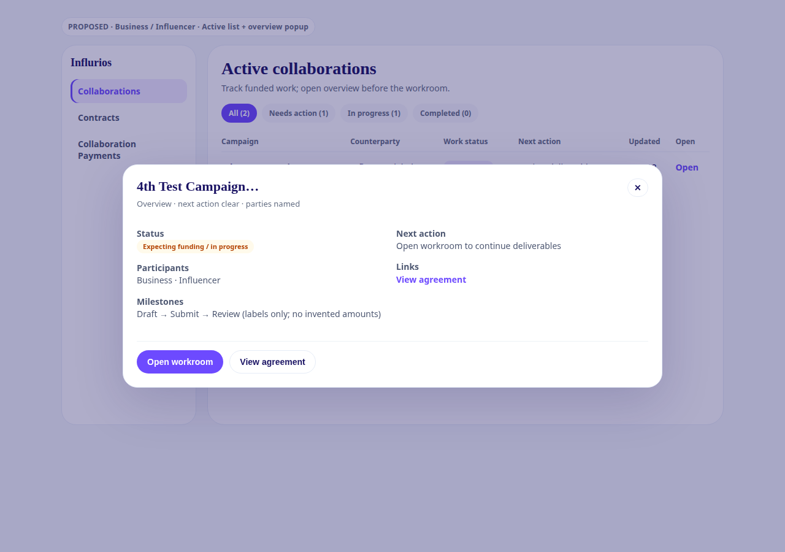

# Design — Active collaborations

**Visual design:** [active-collaborations.html](./active-collaborations.html) · [previews/active-collaborations.png](./previews/active-collaborations.png)  
**Delta evidence (safe):** `media/visual-audit-deltas/2026-11-18/screenshots/{business,influencer}/*/active-*.png`

**Objective:** Consistent Active list + overview popup with path to workroom.  
**Roles:** Influencer & Business  
**Evidence:** `influencer/desktop/collab-hub.png`, business Collaborations tabs on `biz-collab.png`  
**Example rows (labels only):** 4th Test Campaign (Funded), 3rd Testing Colabs (Payment pending), 2nd Collaboration Test (Expecting funding)

---

## 1. Desktop list

Shared columns/cards:

| Field | Content |
|-------|---------|
| Title | Campaign name |
| Status badge | Funded / Expecting funding / Payment pending / … |
| Counterparty | Business or Influencer name |
| Next action | Single verb CTA |
| Progress | Milestone summary or “—” |

Influencer hub may keep Overview dashboard **and** Active tab — Active tab is the canonical list for popup pattern.

---

## 2. Overview popup

Rendered proposal: [active-collaborations.html](./active-collaborations.html). Staging read-only evidence: delta `active-overview-popup.png` / `active-detail.png`.

- Centered; not right rail (hub’s “Upcoming deadlines” widgets may remain on page, but **row detail** is popup)  
- Workroom = dedicated `/collaboration/work/[fundingId]` (full page)

---

## 3. Mobile

Card list → full-screen overview → Workroom page

---

## 4. Empty / error

- Empty Active: “No active collaborations” + Find opportunities / New request  
- Error loading milestones: retry in popup

---

## 5. Confirmation

None for open; funding/release confirmations stay in payment/workroom flows (sandbox only).
