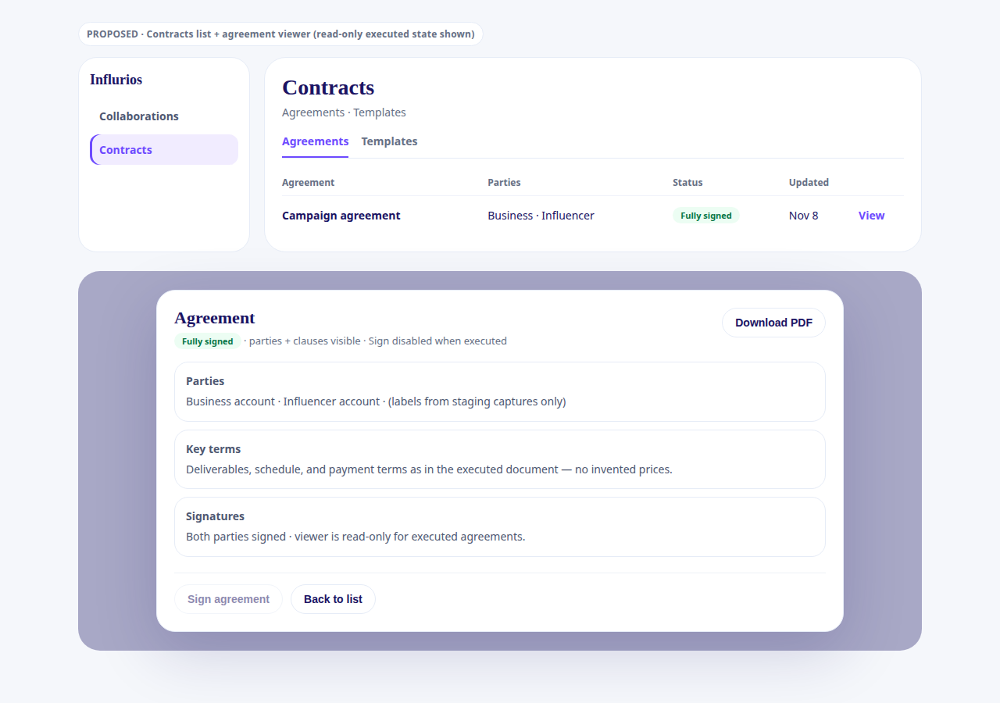

# Design — Contracts

**Objective:** Professional agreement viewing with integrity; list stays simple.  
**Visual design:** [contracts.html](./contracts.html) · [previews/contracts.png](./previews/contracts.png)  
**Baseline evidence:** influencer/business `contracts.png` (#532)  
**Delta evidence (safe, no sign):** `media/visual-audit-deltas/2026-11-18/screenshots/{business,influencer}/*/contract-viewer.png`  
**Example:** Campaigns with IDs like IC-9BMTKC2J · Signature status Fully signed (from capture)

---

## 1. Desktop list

Keep Agreements | Templates tabs, search, status filter, **View agreement**.

---

## 2. Agreement viewer (full-screen dialog)

See [contracts.html](./contracts.html). Staging viewer captured read-only (did **not** submit signature).

- Not a narrow under-table panel  
- Executed docs read-only; amendments = new version  

- Resolve placeholder / contradictory status before sign CTA enabled  

---

## 3. Mobile

Full-screen viewer; sticky action bar

---

## 4. Empty / error / confirmation

- Empty templates vs empty agreements — distinct copy  
- Sign confirm: “You are signing version N as [Party]”
