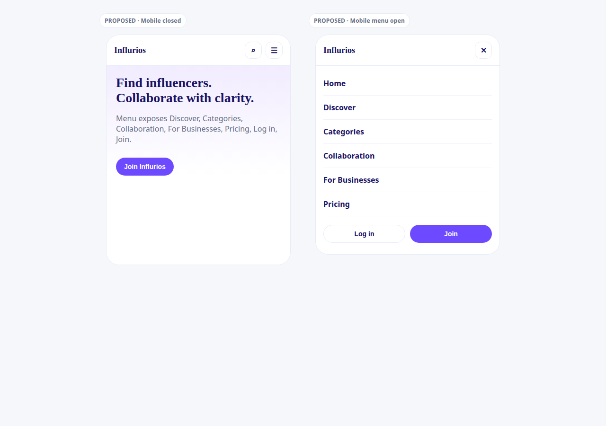

# Design — Mobile public navigation & login

**Objective:** Restore discoverability of nav + Log in on small screens.  
**Visual design:** [mobile-public-nav.html](./mobile-public-nav.html) · [previews/mobile-public-nav.png](./previews/mobile-public-nav.png)  
**Evidence (observed defect):** `media/visual-audit/screenshots/public/mobile/home.png` (#532)  
**Issues:** MOBILE-NAV-001, MOBILE-LOGIN-001 (**observed defects**, not untested gaps)

---

## 1. Header (menu closed)

Logo · search · **menu control** · Join. Menu button `aria-label="Open menu"`. Log in may sit beside Join or inside the menu if the control is obvious.

---

## 2. Menu open (full-screen or sheet)

Links: Home · Discover · Categories · Collaboration · For Businesses · Pricing · **Log in** · **Join**.

- Focus trap; Esc closes; return focus to ☰  
- Log in → `/login`  
- Join → role-aware entry (claim vs business) per nav map

---

## 3. Login path

From menu Log in → existing `/login` form (already captured desktop/mobile).  
Empty validation already OK.

---

## 4. Empty / error

N/A beyond standard login errors.
