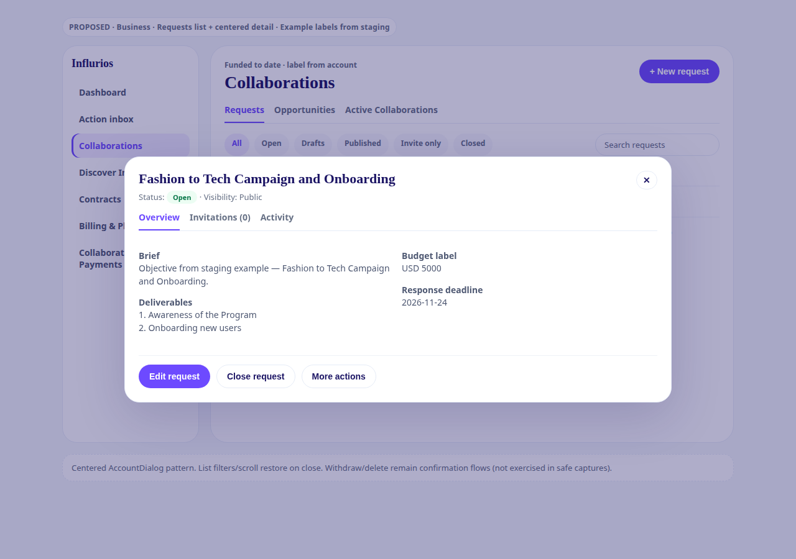

# Design — Business requests

**Objective:** Manage collaboration requests with clear list + centered detail/edit.  
**Primary action:** + New request  
**Data source:** Business workspace briefs / marketplace requests (staging examples: Fashion to Tech…, 4th Test Campaign…)  
**After action:** Return to filtered list; scroll/filters preserved  
**Roles:** Business owner/admin seat  
**Visual design:** [requests.html](./requests.html) · [previews/requests.png](./previews/requests.png)  
**Baseline evidence:** `media/visual-audit/screenshots/business/desktop/biz-collab.png` (#532)  
**Delta evidence (safe):** `media/visual-audit-deltas/2026-11-18/screenshots/business/*/requests-list.png`, `request-detail-popup.png`, `request-edit.png`

---

## 1. Desktop list (default)



See interactive layout in [requests.html](./requests.html).

- **View** → centered detail popup  
- **⋯** → Edit (if eligible), Close, Withdraw participants…, Delete (if eligible), Open collaboration (if signed/funded)

---

## 2. Detail popup (desktop)

```
            ╔══════════════════════════════════════╗
            ║ Request · Fashion to Tech…        ✕ ║
            ║ Status: Open · Visibility: Public    ║
            ║──────────────────────────────────────║
            ║ Summary · Budget label · Dates       ║
            ║ Participants / invitations table     ║
            ║ Lifecycle: Publish · Invite · Close  ║
            ║──────────────────────────────────────║
            ║ [Edit]              [Close request]  ║
            ╚══════════════════════════════════════╝
```

- Wide dialog OK  
- If signed/funded history exists: show banner “Contracts & payments are retained — use Cancel/Close collaboration”

---

## 3. Edit popup

Same shell; form fields for brief content; sticky **Save draft** / **Publish** / **Send invites**  
Unsaved guard on ✕/Esc  
Locked fields when `campaignEditLocked` (existing product rule)

---

## 4. Mobile

Full-screen popup; list as cards with Status + View  
Menu ⋯ → action sheet

---

## 5. Empty / error

- Empty: “No requests yet” + + New request  
- Error: inline banner in popup; list unchanged

---

## 6. Withdraw & delete confirmations

**Withdraw participant** (required before delete when accepted participants exist):

```
╔ Withdraw participant ══════════════╗
║ Who: [Influencer label]            ║
║ Reason * [________________]        ║
║ A notification record will be kept ║
║ [Cancel]     [Withdraw]            ║
╚════════════════════════════════════╝
```

**Delete request** (only if eligible):

```
╔ Delete request? ═══════════════════╗
║ Permanent for this draft/open item ║
║ Does not erase contracts/payments  ║
║ [Cancel]              [Delete]     ║
╚════════════════════════════════════╝
```

If not eligible → route to **Cancel/close collaboration** workspace instead of delete.
