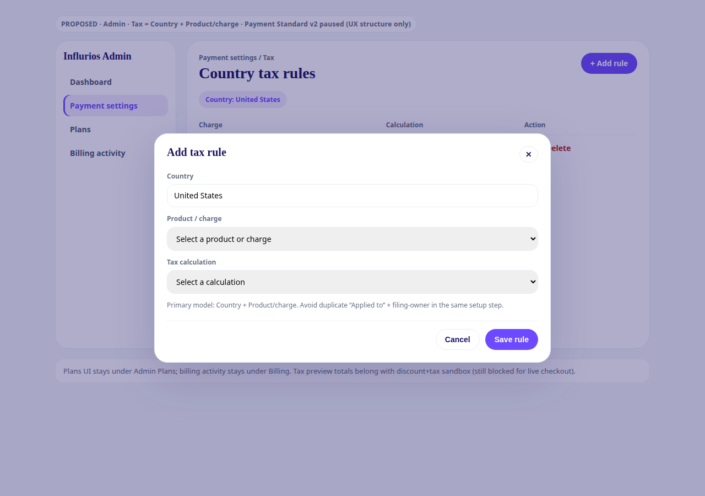

# Design — Tax configuration & admin plan/billing split

**Objective:** Simple Country + Product/charge tax setup; clean plan vs billing IA.  
**Visual design:** [tax-admin-plans.html](./tax-admin-plans.html) · [previews/tax-admin-plans.png](./previews/tax-admin-plans.png)  
**Baseline evidence:** `admin-plans.png`, payment-settings captures (`admin-payment-fees.png`, section UIs)  
**Delta evidence (safe, unsaved):** `media/visual-audit-deltas/2026-11-18/screenshots/admin/*/tax-settings.png`, `tax-edit.png`  
**Note:** Payment Standard v2 paused — this is UX structure only. Captures opened Add/Edit UI without Save/Delete/Sync.

---

## 1. Tax list

Payment settings → Tax · **+ Add tax rule** · Country filter · Charge / Action table (as on staging).

---

## 2. Edit / add popup

Primary fields observed and proposed: **Country** · **Product / charge** · **Tax calculation**.

- No duplicate “Applied to” if same as Product/charge  
- No filing-owner/status controls here  
- Preview totals for discount+tax remain **blocked** for live checkout sandbox  

---

## 3. Admin plans

Keep Plans & features matrix + Create plan dialog.  
Billing activity separate — customer subscriptions/invoices only.
